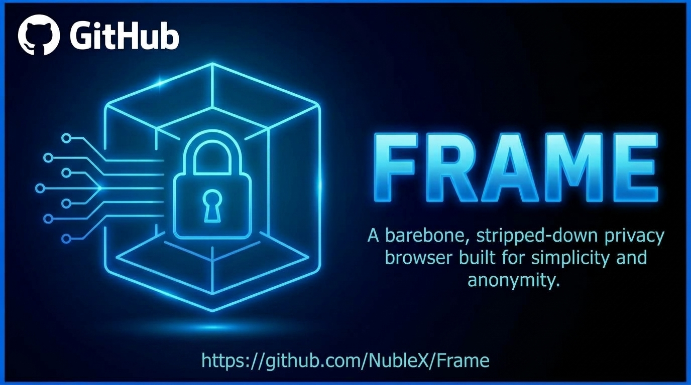
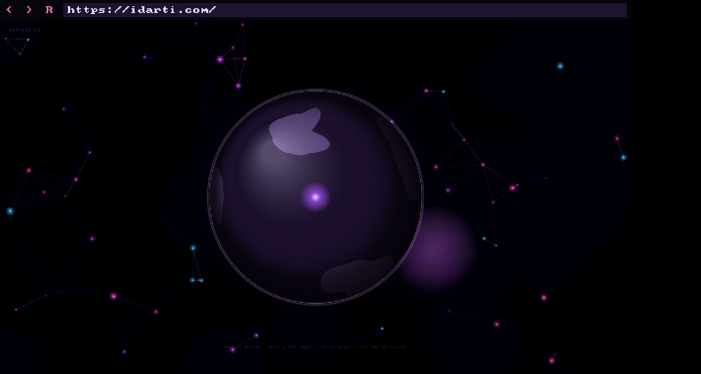
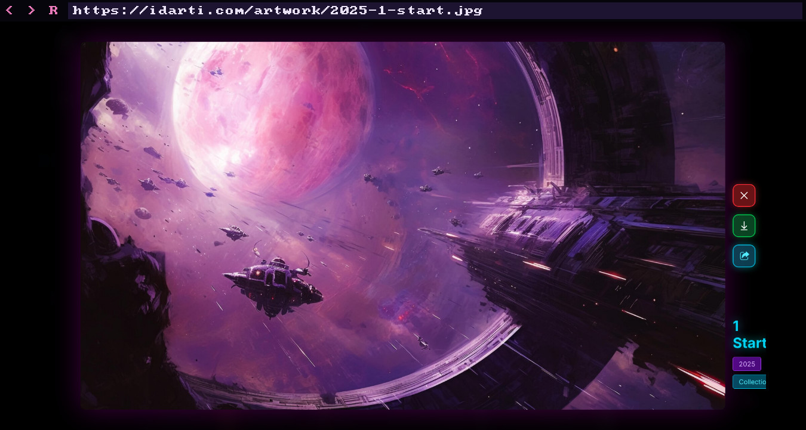
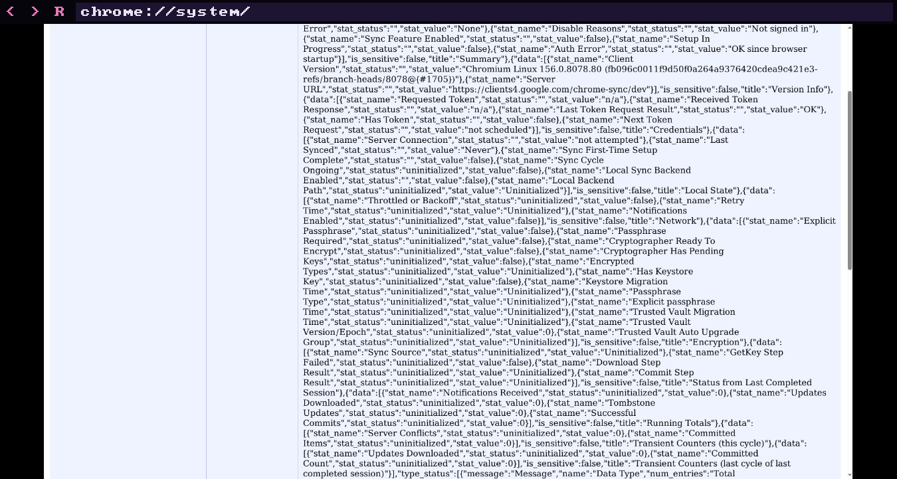

<div align="center">



# Frame

**A standalone browser with a boring outside.**
Your frame into the data world of Aurelia.

[](https://github.com/NubleX/Frame/releases)
[](LICENSE)
[](#status)
[](#limits-of-this-release)
[](Cargo.toml)
[](prototype/README.md)
[](Cargo.toml)
[](docs/proofs.md)
[](docs/threat-model.md)



</div>

Frame runs the web inside a disposable microVM on your machine. The VM has no network card, the browser inside it is sandboxed, and all that reaches your desktop is pixels. Your computer lends CPU, RAM, a network link and one window. When you close the window, the machine is gone.

It is an [ID ArtCraft](https://idarti.com) project, free software under the GPL.

## Status

**Version 0.0.1 is a working prototype, not a safe browser yet.** You can browse, search and watch it refuse to touch your network, but nothing here has been audited. Do not rely on it to protect anything that matters. [What it does not do](#limits-of-this-release) matters as much as what it does.

## What works today

| | |
|---|---|
| **Browsing** | Real web pages, with JavaScript, in a 1 GiB microVM |
| **Navigation** | Address bar, back, forward, reload, zoom, keyboard and mouse |
| **No network card** | The guest has no network device and no routes |
| **One way out** | All traffic goes through one small gate, written in safe Rust |
| **No way back in** | The gate refuses your host, your LAN and every other non-public address |
| **Two walls** | Chromium's sandbox inside the VM, and the VM around it |
| **Jailed VMM** | The process running the VM sees none of your files, processes or network |
| **Burn on close** | The guest root is read-only, so what a session writes lives in guest RAM and ends with it |
| **Nothing left behind** | The window owns the VM and gate. Even `kill -9` leaves no process running |

<table>
<tr>
<td></td>
<td></td>
</tr>
<tr>
<td align="center">A real site, in a microVM</td>
<td align="center">Chromium's internal pages work too</td>
</tr>
</table>

## How it works

```
        THE WEB
           ^
           |  public addresses only
    +------+---------------------------------------------+
    |  frame-gate      safe Rust, the only way out       |  HOST
    |  viewer          the window: pixels in, commands   |
    |                  out, and the address bar          |
    |  launcher        jails itself, then runs the VM    |
    +------+-----------------------+---------------------+
           |  vsock channels only  |
    +------+-----------------------+---------------------+
    |  microVM: no NIC, no routes, read-only root        |
    |  +----------------------------------------------+  |  GUEST
    |  |  Chromium sandbox: renderer, network service |  |
    |  +----------------------------------------------+  |
    |  engine: unprivileged, off-screen rendering        |
    +----------------------------------------------------+
```

The guest has exactly three channels to the outside, and nothing else:

| Channel | Direction | Carries |
|---|---|---|
| Pixels | Out | Finished frames, size-checked by the viewer |
| Membrane | Both | A closed set of typed commands in, and strictly parsed reports out |
| Gate | Both | Web traffic, to public addresses only |

### Isolation comes from code

Frame does not depend on how a machine is set up. The rules live in code that behaves the same everywhere:

- **The gate cannot express a forbidden address.** Only a `PublicAddr` can open a connection, and that type cannot hold the host, the LAN or any other non-public address. There is no flag to get wrong.
- **The VM jails itself.** Before any VM code runs, the launcher enters its own namespaces, drops to a root holding only what it needs, and gives up all capabilities. If a step fails, it does not start.
- **The guest image carries its own settings**, including Chromium's flags, so the host's resolver, locale and hostname never reach it.
- **Only three parts are written per OS:** the hypervisor, the self-jail and the channel. See [ADR 0009](docs/adr/0009-one-guest-thin-host.md).

### Bare, not masked

Privacy browsers often stand out through how hard they hide. Frame takes the opposite approach: no canvas noise, no spoofed values, no claiming to be something it is not. It runs a plain Chromium with the bare minimum around it, and the protection sits outside, where a page cannot see it.

Anonymity is where Frame is heading, and it is not there in 0.0.1. On the default route, sites see your IP address like any browser. Routes that hide it are on the [roadmap](docs/roadmap.md).

## Measured

On one laptop: 2 cores, 8 GB of RAM, Linux x86_64. These are single runs, not benchmarks.

| What | Result |
|---|---|
| Guest memory | 1 GiB per compartment |
| CEF ready after start | About 0.6 s |
| `example.com` loaded | About 1.9 s from a cold start |
| Memory free in the guest during browsing | 500 MiB or more |
| Guest libraries | 89 cut to 26, without rebuilding Chromium |
| Guest image | 345 MB, nearly all of it `libcef.so` |

## Checked, not just claimed

| Check | Covers |
|---|---|
| [`test-isolation.sh`](prototype/test-isolation.sh), 17 checks | A real guest tries to reach real listeners on the host and LAN. The jailed VMM is inspected from outside. The sandbox is read from the guest kernel |
| [Kani proofs](docs/proofs.md), 10 properties | Every IPv4 and IPv6 address is classified correctly, and `PublicAddr` can never hold a forbidden one |
| Rust tests, 107 | Hostile input to the gate and membrane, policy, lifecycle and viewer |
| `chrome://sandbox` | Chromium's own verdict: "You are adequately sandboxed" |

The full decoders are **not** proven: they rest on tests. [docs/proofs.md](docs/proofs.md) lists exactly what is and is not covered.

## Build and run

Tested on Kali Linux, x86_64 only. You need:

- A CPU with KVM, and write access to `/dev/kvm`
- Rust, a C toolchain, `cmake`, `ninja`, `git`, `curl` and `busybox`
- Chromium's shared libraries on the build machine, because the guest image is assembled from them. Installing your distribution's `chromium` package is the simple way
- About 5 GB of disk

One command fetches pinned, hash-checked dependencies and builds everything into a folder of your choice. Nothing is installed system-wide.

```bash
prototype/setup.sh ~/frame-work
```

Start the browser:

```bash
prototype/run.sh ~/frame-work https://example.com
```

Prove the isolation on your machine:

```bash
prototype/test-isolation.sh ~/frame-work
```

### Using it

| Keys | Does |
|---|---|
| Click the bar, or Ctrl+L | Edit the address, then Enter. Esc cancels |
| `<` `>` `R`, or Alt+Left, Alt+Right, F5 | Back, forward, reload |
| Ctrl with `+`, `-` or `0`, or Ctrl+wheel | Zoom in, out, reset |

There is no search engine built in: what you type is where you go. To look under the hood, try `about:about`, `chrome://version` or `chrome://sandbox`.

Pages always render at 1920x1080 whatever your window size, so your screen cannot leak to websites. On a smaller screen, use zoom.

### Developing

```bash
cargo test --workspace
```

```bash
cargo clippy --workspace --all-targets -- -D warnings
```

Proofs need [Kani](https://github.com/model-checking/kani): run `cargo kani` inside `crates/frame-gate` or `crates/frame-membrane`.

## Limits of this release

- **Not audited.** No claim here has had an external review.
- **Linux x86_64 only.** Frame is designed for any host OS, but only this one is built and tested. An OS with no jail refuses to start.
- **Print not measured.** The goal is to look like ordinary Chromium on Linux, but the comparison against stock Chromium has not been run. The User-Agent is stock, with no CEF token.
- **Traffic goes through a proxy, not a virtual NIC yet.** UDP does not pass, so there is no QUIC or WebRTC, which sites can notice.
- **The gate runs as a host process**, not yet in its own microVM.
- **No system call filter on the VMM yet.**
- **A compromised host defeats Frame.** It protects your machine from the web, not you from your machine.
- **A page can still reach what you give it.** Burning the box does not unsend a password typed into a phishing page.
- **Your IP is visible** on the default route, and sites can recognise a login as with any browser.
- **Missing features:** tabs, downloads, clipboard, file upload, and Ctrl shortcuts other than zoom. Video is untested.
- **Scope of isolation.** "No path exists" describes this code. It does not remove bugs in KVM, libkrun or the kernel.

The full picture is in the [threat model](docs/threat-model.md).

## Roadmap

| Stage | Delivers | State |
|---|---|---|
| Foundation | Architecture, threat model, core crates | Done |
| Barebone browser | Isolated browsing with sandbox, gate and address bar | **Done in 0.0.1** |
| Spikes | Print test, gate in its own microVM with tun2socks, response stripping, Servo panels | Next |
| Alpha | Broker with control API, Aurelia shell | Planned |
| Beta | Identities, disposables, routes, signed updates, external pentest | Planned |
| Add-ons and Roles | Wasm add-ons, Frame Profiles, own Chromium build | Planned |
| Agile | macOS, Windows, portable USB, remote node | Planned |
| Metal | Bootable appliance, then phone and car | Planned |

Details and estimates are in the [roadmap](docs/roadmap.md).

## Repository

| Path | Holds |
|---|---|
| [`crates/`](crates/) | Core libraries in safe Rust, with `unsafe` forbidden |
| [`prototype/`](prototype/) | The browser: launcher, engine, viewer and guest image |
| [`docs/`](docs/) | Architecture, threat model, proofs, roadmap and decisions |
| [`spikes/`](spikes/) | Experiments and their measured results |
| [`spec/`](spec/wit/addon.wit) | The draft add-on interface |
| [`fuzz/`](fuzz/) | Fuzz target for the membrane, not yet run |

| Crate | Owns |
|---|---|
| `frame-gate` | The only way out of a compartment |
| `frame-membrane` | The strict one-way wire format |
| `frame-policy` | The ordered default-deny guard |
| `frame-vmm` | The VMM boundary and fixed virtual hardware |
| `frame-compartment` | Idempotent compartment lifecycle and crash recovery |
| `frame-siem` | Shield SIEM event store, ported from the browser extensions |
| `frame-profile` | Role manifests |

The prototype does not use every crate yet: `frame-gate` and `frame-membrane` run in it today, and the others are tested libraries waiting for the broker.

## Read more

- [Architecture](docs/architecture.md)
- [Threat model](docs/threat-model.md)
- [Proofs](docs/proofs.md)
- [Decisions](docs/adr/)
- [Prototype notes](prototype/README.md)

## Credits

**Frame exists because of the [Chromium Embedded Framework](https://github.com/chromiumembedded/cef).** CEF is the engine of this browser: it is what lets Frame render real web pages off-screen and hand over nothing but pixels. Thank you to Marshall Greenblatt, who created it, and to everyone who has maintained it since. Thanks also to [Spotify](https://cef-builds.spotifycdn.com/index.html) for hosting the CEF builds Frame downloads, and to the [Chromium](https://www.chromium.org/) project underneath it all.

Frame also stands on:

| Project | Used for |
|---|---|
| [cef-rs](https://github.com/tauri-apps/cef-rs) | The Rust bindings to CEF |
| [libkrun and libkrunfw](https://github.com/containers/libkrun) | The microVMs |
| [minifb](https://github.com/emoon/rust_minifb) | The window |
| [Kani](https://github.com/model-checking/kani) | The proofs |

This release is source only: it ships none of their binaries, and `setup.sh` fetches them under their own licences.

## Licence

GPL-3.0. See [LICENSE](LICENSE).
