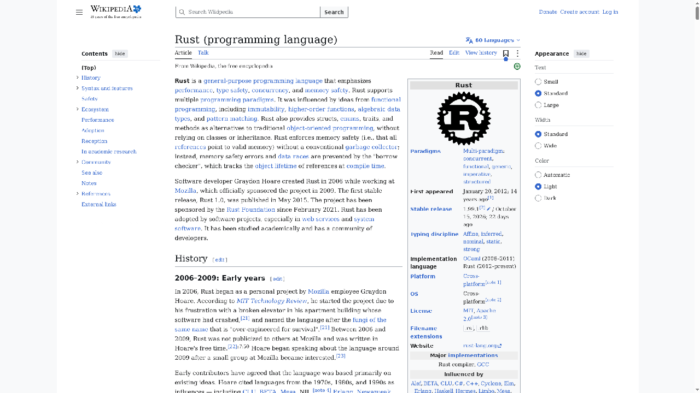

# Spike 1 results

**Passed, 2026-11-06.** A live page rendered by CEF inside a libkrun microVM appears in a Rust window on the host. It fits in 1 GB, and also worked at 512 MB.



More screenshots: [example.com](results/example-1024.png), [idarti.com](results/idarti-1024.png).

## Measurements

One run each, on this laptop, while other work was running: 7.6 GiB RAM, 4 threads, no GPU in the guest, 2 vCPUs, 1920x1080, frame cap 15 per second.

| Page | Guest RAM | Load finished | Lowest free in guest | Host VMM peak RSS | Average CPU | Frames/s |
|---|---|---|---|---|---|---|
| example.com | 1024 MiB | 1.6 s | 799 MiB | 440 MiB | not measured | about 1, static page |
| Wikipedia, Rust article | 1024 MiB | 3.5 s | 668 MiB | 592 MiB | about 39% of one core | 11-13 |
| idarti.com, animated | 1024 MiB | 1.6 s | 613 MiB | 656 MiB | about 91% of one core | 15, the cap |
| Wikipedia, Rust article | 512 MiB | 2.4 s | 193 MiB | 530 MiB | about 38% of one core | 11-13 |

Other figures:

- A bare guest booted, ran a command and shut down in 0.32 s, using 31 MiB.
- CEF was ready 0.58 s after the engine started.
- `libcef.so` shrinks from 1.48 GB to 278 MB when stripped.
- The whole guest root is 367 MB.

CPU is averaged over the run from the VMM process, so it excludes the viewer. These are single runs, so treat them as indications, not benchmarks. 512 MiB is the lowest size tried, not a proven floor.

## What this did not test

- **Scrolling and input.** There is no input path yet, so the planned CPU-while-scrolling figure was not measured.
- **Video and WebGL.** All runs used `--disable-gpu`. The persona's WebGL through SwiftShader adds a process and needs its own measurement.
- **Heavy web apps and long sessions.** Memory growth over hours is unknown.
- **Several compartments at once.**

## How this differs from the target design

Nothing here is safe to use yet.

| Spike | Target |
|---|---|
| Guest runs as root with Chromium's sandbox off | Non-root guest user with the sandbox on |
| Network through libkrun TSI, straight to host sockets | Through the gate only. Invariant 3 is not met here |
| Root is a writable host folder over virtiofs | Read-only image |
| VMM runs unjailed | VMM jailed, with no host paths |
| Host resolver copied into the guest | DNS owned by the gate. Invariant 4 is not met here |
| Raw frames, about 8 MB each | Damage rectangles or draw commands |

## Findings for the design

1. **1 GB is enough for ordinary pages.** `CANONICAL_HARDWARE` drops from 2048 to 1024 MiB.
2. **`--ozone-platform=headless` is required.** Without it Chromium looks for an X display. No display server is needed, as ADR 0003 assumed.
3. **DNS must not be assumed.** This network refuses outside resolvers, including from the host, so a hardcoded public resolver failed. The gate has to work with what the network allows.
4. **Runtime libraries are invisible to `ldd`.** NSS modules are loaded at runtime and must be listed by hand in the image build.
5. **Fonts are a real decision.** With only DejaVu, CJK text shows as empty boxes. The bundled font set affects both usability and the print, so Spike 2 should settle it.
6. **`ERR_CERT_VERIFIER_CHANGED` appeared once** on the first Wikipedia load, and the page then loaded. It looks like a startup race. Worth watching.
7. **D-Bus errors fill the log** because the guest has no bus. They look harmless but need silencing.

## Reproduce

Pinned inputs:

| Input | Version | Check |
|---|---|---|
| libkrun | v1.19.8, commit `c4d283c` | built from source |
| libkrunfw | v5.6.2, `libkrunfw-x86_64.tgz` | sha256 `016c32dd...7c8b91` |
| CEF | 156.0.15, Chromium 156.0.8078.80 | sha1 `09235427...98a4f8a` for the minimal archive; `cef` crate 156.3.0 downloads and checks its own copy |

```bash
CEF_PATH=<work>/cef-store CARGO_TARGET_DIR=<work>/target KRUN_LIB_DIR=<work>/prefix/krun cargo build --release
```

```bash
./build-rootfs.sh <work>/target/release/engine <work>/cef-store/156.0.15/cef_linux_x86_64 <work>/root
```

```bash
./run.sh <work> 1024 40 https://example.com/ --ozone-platform=headless --disable-gpu --disable-gpu-compositing
```

`<work>/prefix/krun` holds the libkrun and libkrunfw shared libraries.
